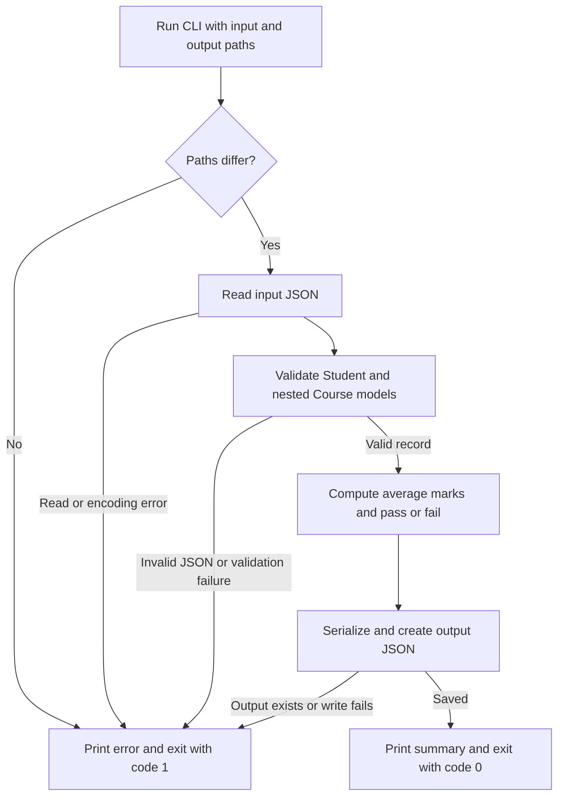

# Student Record Validator

A beginner-friendly Python command-line project using Pydantic v2 to validate student JSON records, compute results, and export structured data. No API key, database, web server, or paid service is required.

## Workflow

The CLI reads one student record, validates it with Pydantic, and exports a report when all checks pass.



Validation checks field types, required values, marks, unique course names, and credit limits. The original input and any existing output file are protected from overwrite.

## Rules

- Name and course names must contain non-whitespace text; surrounding whitespace is trimmed.
- Student IDs use S followed by digits, e.g. S101.
- At least one course is required; course names must be unique ignoring case.
- Marks must be finite numbers between 0 and 100 inclusive. Numeric strings such as "78" are converted.
- Credits are strict integers; required credits must be positive; completed credits cannot exceed required credits.
- Unknown fields are rejected to catch misspelled keys.
- The average is an unweighted arithmetic mean, rounded to two decimal places.
- PASS requires at least 40 in every course. This is a demonstration rule, not BRAC University's grading policy.

The exported JSON includes computed fields (`average_marks` and `result`). It is a report, not a raw input record. Remove those two fields if you want to validate an exported report as new input.

## What you learn

| Feature | Implementation |
| --- | --- |
| BaseModel and Field | Student/Course schemas, ranges and ID pattern |
| Field validators | Trim text and reject duplicate courses |
| Model validator | Compare completed and required credits |
| Computed fields | Average marks and overall result |
| Nested models | A student's list of Course objects |
| Serialization | model_dump_json() exports |
| Error handling | ValidationError and readable CLI errors |
| Tests and CI | unittest suite and GitHub Actions |

## Files

- `models.py`: data models and business validation.
- `main.py`: CLI input, output, and error handling.
- `examples/`: valid and invalid inputs.
- `tests/`: validation and CLI tests.
- `.github/workflows/tests.yml`: runs tests on pushes and pull requests.

```

## Possible extensions

Add batch processing, CSV export, or a FastAPI endpoint after understanding the current validation flow.
